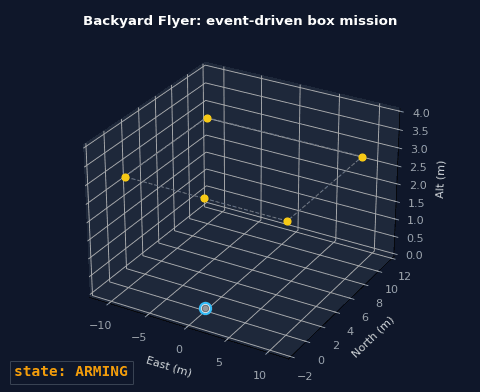
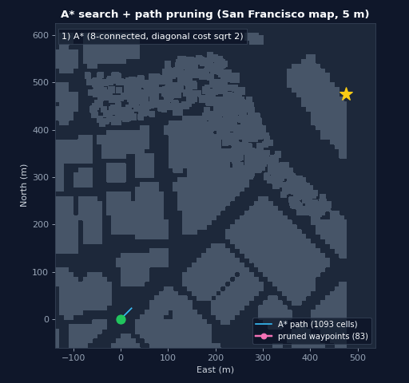
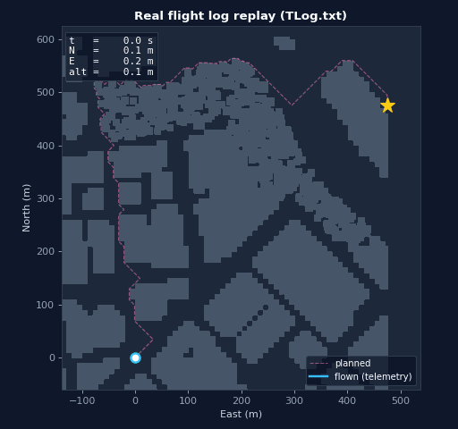
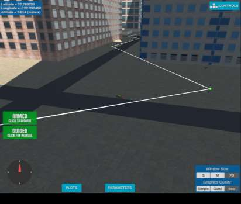
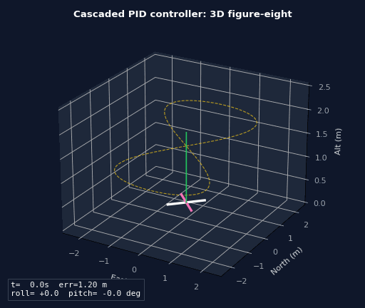
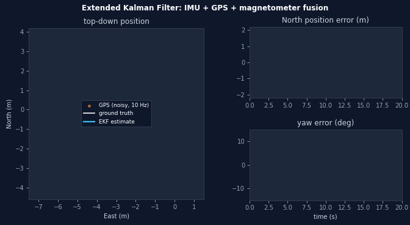

# Udacity Flying Car and Autonomous Flight Engineer – My Projects

This repo has the projects I completed in the Udacity **Flying Car and Autonomous Flight Engineer** Nanodegree (FCND). Each one covers a different part of making a drone fly on its own: running a mission, planning a path, controlling the vehicle, and estimating where it is.

| # | Project | Language | Topics |
|---|---------|----------|--------|
| 1 | [Backyard Flyer](#1-backyard-flyer) | Python | Event-driven programming, state machines, MAVLink |
| 2 | [3D Motion Planning](#2-3d-motion-planning) | Python | Configuration space, A\* search, path pruning |
| 3 | [Control of a 3D Quadrotor](#3-control-of-a-3d-quadrotor) | C++ | Cascaded PID control, motor mixing, gain tuning |
| 4 | [Flight Estimation](#4-flight-estimation-ekf) | C++ | Sensor noise, complementary filter, Extended Kalman Filter |

---

## 1. Backyard Flyer

<p align="center"></p>

The first project was to make the drone take off, fly a box (10 m × 20 m at 3 m altitude), return to the start, land and disarm.

The mission isn't a timed script. I built it as a state machine that reacts to telemetry callbacks from the simulator:

```
MANUAL → ARMING → TAKEOFF → WAYPOINT (x5) → LANDING → DISARMING → MANUAL
```

- `state_callback` handles arming and taking control, and starts the takeoff once the drone is armed and guided.
- `local_position_callback` sends the next waypoint when the drone gets within 1 m of the current one. After the last waypoint, it waits until the speed drops below 0.1 m/s and then lands.
- Once the altitude is under 0.1 m, the drone disarms and releases control.

Code: [`backyard_flyer/backyard_flyer.py`](backyard_flyer/backyard_flyer.py)

---

## 2. 3D Motion Planning

<p align="center">
  
  
</p>

In this project I planned and flew a route through downtown San Francisco without hitting any buildings. The obstacle data comes from `colliders.csv`, which has 3,845 buildings.

What I implemented:

1. **Grid map**: `create_grid()` turns the obstacles into a 2D occupancy grid at the flight altitude (5 m), with a 5 m safety margin around each building.
2. **Home position**: I set home from the map's reference lat/lon (`37.792480, -122.397450`) and used the drone's current local position as the start cell.
3. **A\* search**: I added diagonal moves (cost √2) to the action set and made the valid-action check handle diagonals and the grid edges.
4. **Path pruning**: I used a collinearity check (determinant of three points) to drop waypoints that lie on a straight line. For the route above, this cut 1,093 grid cells down to 83 waypoints.
5. **Flying it**: the waypoints are sent to the simulator, and the drone follows them using the same state machine as the Backyard Flyer, with an extra `PLANNING` state.

The left animation shows A\* and the pruning step on the map. The right one is a replay of my actual flight log (`Logs/TLog.txt`) from the simulator. The route is about 1.3 km at 5 m altitude and took around 7.5 minutes to fly.

<p align="center"><br><sub>The drone following the plan in the simulator</sub></p>

Code and write-up: [`3D_Motion_Planning/home/FCND-Motion-Planning.zip`](3D_Motion_Planning/home/FCND-Motion-Planning.zip). It contains `motion_planning_with_Bresenham.py`, `planning_utils_with_Bresenham.py` and `3D Motion Planning_Writeup.pdf`.

---

## 3. Control of a 3D Quadrotor

<p align="center"></p>

For this project I wrote the flight controller in C++. It takes a desired trajectory and works out the thrust for each of the four motors through a chain of controllers:

```
 position ─► Lateral PD ─► accel ─► Roll/Pitch P ─► p,q ─┐
 altitude ─► Altitude PID ─► collective thrust ──────────┼─► Body-rate P ─► moments ─► Motor mixing ─► 4 thrusts
 yaw      ─► Yaw P ─────────────────────────────── r ────┘
```

| Function | What I did |
|---|---|
| `GenerateMotorCommands` | Solved for the four rotor thrusts from the collective thrust and the three moments, using the arm length `L` and drag/thrust ratio `kappa` |
| `BodyRateControl` | P controller on p, q, r, multiplied by the moments of inertia |
| `RollPitchControl` | Converts the lateral acceleration command into roll/pitch rate commands using the rotation matrix, with the tilt limited to 0.7 rad |
| `AltitudeControl` | PID with feed-forward. I added the integral term with a clamp to handle the wrong-mass vehicle in scenario 4 |
| `LateralPositionControl` | Cascaded PD with speed and acceleration limits |
| `YawControl` | P controller on yaw |

My final gains ([`QuadControlParams.txt`](Control_of_3D_Quadrotor/Controls_Project/QuadControlParams.txt)):
`kpPosXY=3, kpPosZ=10, KiPosZ=70, kpVelXY=12, kpVelZ=24, kpBank=12, kpYaw=2, kpPQR=(69,69,5)`

The animation runs my controller with these gains on a figure-eight trajectory. After the first lap, the position error stays around 0.1 m.

Code and write-up: [`Control_of_3D_Quadrotor/Controls_Project/`](Control_of_3D_Quadrotor/Controls_Project/)

---

## 4. Flight Estimation (EKF)

<p align="center"></p>

The last project was the state estimator. I wrote an Extended Kalman Filter in C++ with the state `[x, y, z, vx, vy, vz, yaw]`. It fuses three noisy sensors: the IMU, GPS and the magnetometer.

| Step | What I did |
|---|---|
| Sensor noise | Calculated the standard deviation from the logged sensor data: GPS X/Y = 0.7 m, accelerometer X/Y = 0.5 m/s² |
| Attitude estimation | Replaced the small-angle integration with a non-linear complementary filter that uses the full Euler-angle rate matrix |
| Prediction | `PredictState()` integrates the IMU acceleration in the world frame. `GetRbgPrime()` and the Jacobian `g'` update the covariance |
| Magnetometer update | Yaw update, with the angle difference wrapped to ±π |
| GPS update | Position and velocity update |
| Closed loop | Swapped in my controller from project 3 and re-tuned it to work with the estimated state |

In the animation, the orange dots are raw GPS readings (about 0.9 m of error). The blue line is the filter's estimate, which stays within about 0.13 m of the real position. The shaded bands show the filter's ±2σ uncertainty.

Code and write-up: [`Stat_Flight_Estimation/Estimation_solution/`](Stat_Flight_Estimation/Estimation_solution/)

---

## Tools

Python (udacidrone, NumPy, scikit-image), C++, the Udacity FCND Unity simulator, MAVLink

## About the animations

I didn't record my screen while working on the projects, so I made these animations afterwards from my own code, parameters and flight logs. The scripts are in [`media/scripts/`](media/scripts/).

- **Motion planning**: the planning GIF runs my planning code on the map, and the flight GIF uses my recorded telemetry log.
- **Backyard flyer**: the GIF replays my state machine.
- **Controller and estimator**: Python versions of my C++ code, using my tuned values.

To regenerate them (requires `numpy matplotlib pillow scikit-image`):

```bash
cd media
python scripts/make_backyard_flyer_gif.py .
python scripts/make_controller_gif.py .
python scripts/make_estimator_gif.py .
# for motion planning, unzip 3D_Motion_Planning/home/FCND-Motion-Planning.zip first
python scripts/make_motion_planning_gifs.py <path-to>/FCND-Motion-Planning .
```

## License

My own code, write-ups and animation scripts in this repo are released under the [MIT License](LICENSE).

> **Note:** these projects build on material that Udacity provides as part of the FCND program, such as:
> - the starter code and C++ framework around `QuadControl.cpp` and `QuadEstimatorEKF.cpp`
> - the `FCND-Motion-Planning` starter files
> - the FCND Unity simulator build
> - the `udacidrone` library
>
> Those parts belong to Udacity and remain under Udacity's own terms. The MIT license above covers only my own work.
